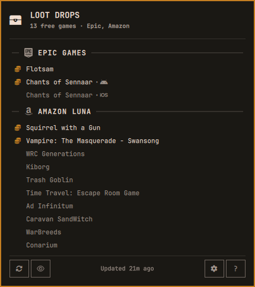
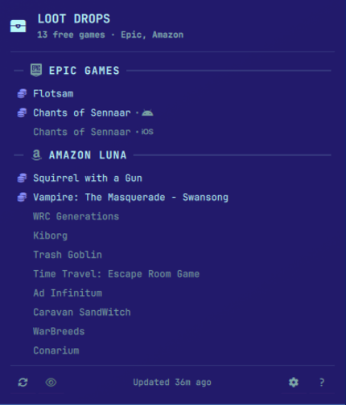
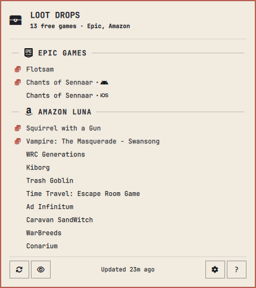
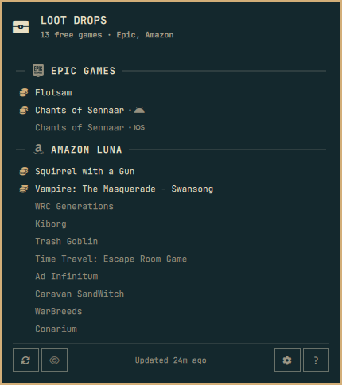
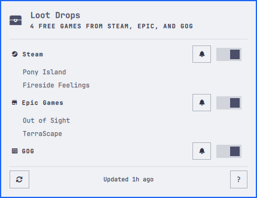

<h1 align="center">Loot Drops</h1>

<p align="center">Never miss a free game drop. Loot Drops watches Steam, Epic Games, GOG, and optionally Amazon Luna for games that are free for a limited time, and alerts you the moment a new one appears.</p>

<p align="center"><a href="https://github.com/tcballard/omarchy-badges"></a></p>

A treasure chest in your bar. Click it and a panel lists everything currently
free to keep, grouped by store, each row one click from the store page. When a
new one appears you get a desktop notification — one per game, with buttons to
open its store page, mark it seen, or open the panel.

**No accounts. No API keys. No logins.** It reads only the stores' own public
pages, and it never writes anything outside its own state directory.

**Amazon Luna is the optional store and is off by default.** Watching its
claims page needs no account, but claiming its games needs an Amazon Prime
membership and is done in your own browser. Loot Drops never signs in.

<p align="center"></p>

**Preview:** Sunlit Sands. A real screenshot from Omarchy 4.0.6-1 on Hyprland,
taken from the live desktop with the panel open. Amazon Luna is switched on, one
Epic game is marked seen and hidden behind the eye, and the list is long enough
to show the fade at its bottom edge. The stores and games in it were real at
capture time, so it will not match what the panel shows later. Desktop
acceptance evidence is in [docs/ACCEPTANCE.json](docs/ACCEPTANCE.json).

## Install

```bash
omarchy plugin add https://github.com/salmun-nister/omarchy-loot-drops --enable right
```

Or clone it yourself and rescan:

```bash
git clone https://github.com/salmun-nister/omarchy-loot-drops \
  ~/.config/omarchy/plugins/salmun-nister.loot-drops
omarchy-shell shell rescanPlugins
omarchy plugin enable salmun-nister.loot-drops right
```

Nothing else to install. `python3`, `curl` and Chromium — all Omarchy base
packages — are already present.

## Removing

```bash
omarchy plugin remove salmun-nister.loot-drops
```

To keep it installed but stop it doing anything, disable it instead:

```bash
omarchy plugin disable salmun-nister.loot-drops
```

Removal takes the plugin folder with it. If you installed it as a plain
directory rather than a git checkout, Omarchy backs that folder up to
`~/.config/omarchy/plugins/.salmun-nister.loot-drops.bak.<timestamp>` instead
of deleting it, so remove it yourself if you want the space back.

Your state file is deliberately kept:
`~/.local/state/salmun-nister.loot-drops/seen.json`. It records what was
already free, so reinstalling does not re-announce games that were free before,
and which games you have marked seen, so your markers survive a reinstall. If
you have used Amazon Luna, that directory also holds the anonymous Chromium
profile its render uses; it carries no account or login. Delete the directory if
you want a clean slate.

Nothing else is changed: no Hyprland setting, and no other entry in
`~/.config/omarchy/shell.json`.

## Using it

| Action | What happens |
| --- | --- |
| Left-click the chest | Open the panel |
| Middle-click the chest | Refresh the stores now |
| Click the eye in the footer | Hide or show the games you have marked seen |
| Click the gear in the footer | Open or close the Settings page |
| Click a game | Open its store page and close the panel |
| Click a game's coin | Mark that game as seen, without opening it |
| `r` | Refresh the stores now |
| `s` | Toggle the highlighted game's seen state (press again to bring its coin back) |
| `v` | Hide or show the games you have marked seen |
| `,` | Open or close the Settings page |
| `j` / `k` | Scroll down / up |
| `?` | Show or hide the shortcut list |
| `Esc` | Leave Settings if it is open, otherwise close the panel |

The shortcut list lives in the README. If you have forgotten it while the panel
is open, press `?` — or click the `?` in the panel's bottom-right corner — and
it appears above the buttons until you press it again.

A coloured dot sits on the top right of the chest while there are free games you
have not marked as seen. Each such game carries a coin marker to the left of its
title in the panel, and the dot stays until every one of them has been marked:
opening the panel no longer clears it by itself. A game is marked when you open
it or click its coin, or `s` toggles the highlighted one, so a game can be put
back to unseen and its coin brought back. A game that turns up later lights the
dot again. The dot is independent of the
notification bells, so a muted store still shows a dot for something you have not
looked at. Like the notification-center badge, it is drawn over the icon rather
than beside it, so the bar does not change width as games arrive.

Each enabled store gets its own section in the panel, headed by the store's mark
— the real Steam, GOG, Amazon and Epic logos; Epic's is bundled because Nerd
Fonts has no mark for it. Games sit slightly indented under their store name,
unseen first. Store watches, notification bells, Epic mobile platforms and
every other setting live in the gear's Settings page, grouped by store.

Hovering a game highlights it exactly as the keyboard cursor does, and the two
never show at once: moving the mouse onto a row clears the keyboard highlight,
and pressing `j`/`k` clears the mouse one. Pressing `j`/`k` while pointing at a
game carries on from that game, so moving from mouse to keyboard starts where
the pointer left off.

A muted store sends no notifications; its games still get their panel coin
marker and light the bar dot. A store you have switched off in Settings no
longer appears in the list at all.

The **eye** in the panel's bottom row hides the games you have already marked
seen, store by store. Each store that had some hidden then ends with a dim line
saying how many — `3 seen games hidden` — so the unseen games always read first.
Click it again, press `v`, or set `hideSeen`, to bring them back; the count in
the subtitle still includes the hidden games.

Right-click does nothing, deliberately.

The panel lists every free game, however many there are. The games scroll between
the two rules while the header and the buttons stay put, and a fade with a small
chevron at the top or bottom edge means there is more in that direction; the
scrollbar itself stays out of the way until you scroll. The keyboard cursor
scrolls itself into view.

## Notifications

Each newly free game gets its own notification, so a few found in one check
stack under a single Loot Drops card. The treasure-chest mark is the
notification icon.

A single game's notification carries three buttons:

| Button | What it does |
| --- | --- |
| **View All** | Open the panel — the same as clicking the notification itself |
| **Open Game Store** | Mark the game seen and open its page in the store offering it |
| **Mark as seen** | Mark the game seen without leaving the notification |

A sudden batch is bundled. Once a store has more new games than the **Per-store
notification limit** setting (3 by default; `1` always bundles a store's batch,
`0` means no limit), that store sends one summary notification instead, and its
only button is **View All**. The buttons call the widget, which
re-derives the same checked link a panel row opens. A muted store sends no
notifications; its games still get their panel coin marker and light the bar
dot.

## Theming

The panel is built from the shell's own theme tokens, so it matches whatever
theme you are running — there is no per-plugin styling to keep in sync. A few of
them:

<table align="center">
<tr>
<td align="center"><br><sub>Aonagi</sub></td>
<td align="center"><br><sub>Sumi Day</sub></td>
</tr>
<tr>
<td align="center"><br><sub>Outpost</sub></td>
<td align="center"><br><sub>Catppuccin Latte</sub></td>
</tr>
</table>

## Settings

Open the Settings page from the gear at the bottom of the panel or with `,`. It
groups every switch by store — watch, notifications, Epic's Android and iOS
feeds — and keeps the refresh interval, the per-store notification limit, the
hide-seen filter and the country code together below them. Changes apply
immediately and are saved to your `shell.json`. The same keys can also be set on
the widget's entry there, or through the Omarchy settings UI, and they hot-reload
on save.

| Setting | Default | What it does |
| --- | --- | --- |
| `refreshMinutes` | `90` | How often to check the enabled stores (30–720). |
| `maxStoreNotifications` | `3` | Per-store cap on individual notifications (0–20). `1` always bundles a store's batch into one summary; `0` means no limit. |
| `hideSeen` | `false` | Hide the games you have marked seen, replacing them with a per-store count. The footer's eye toggles it. |
| `steamEnabled` | `true` | Watch Steam. |
| `epicEnabled` | `true` | Watch the Epic Games Store. |
| `epicMobileAndroid` | `false` | Also list Epic's Android weekly free games under the Epic heading, marked with an Android glyph. Claiming is in the Epic Games app. |
| `epicMobileIos` | `false` | Also list Epic's iOS weekly free games under the Epic heading, marked with an iOS glyph. Claiming is in the Epic Games app. |
| `gogEnabled` | `true` | Watch GOG. |
| `amazonEnabled` | `false` | Watch Amazon Luna. Off by default because it renders a page in headless Chromium; watching needs no account, but claiming its games needs an Amazon Prime subscription. |
| `steamNotify` | `true` | Notify when a Steam game goes free. |
| `epicNotify` | `true` | Notify when an Epic game goes free. |
| `gogNotify` | `true` | Notify when a GOG giveaway runs. |
| `amazonNotify` | `true` | Notify when an Amazon Luna game goes free. |
| `country` | `""` | Optional two-letter store country code (ISO 3166-1: US, DE, GB) used by Steam and Epic, including Epic's mobile feeds. Empty lets Steam and Epic choose; the mobile feed falls back to `US` because it requires one. |

```json
{ "id": "salmun-nister.loot-drops", "refreshMinutes": 90, "gogNotify": false }
```

The Settings page writes the same keys, so you can also set them by hand while
the plugin is off. Switching a store **off** stops it being fetched at all — no
request, no rows, no notifications, and it disappears from the list. Switching it
back **on** re-records that store silently rather than announcing everything it
missed while you had it off. Switching an Epic mobile platform on does the same:
its currently free games are recorded without a burst of notifications.

## How it decides

The default interval trades freshness against how often the stores are asked.
The panel also refreshes itself when you open it and the data is older than a
stale interval, which covers a laptop that was asleep.

The first run is deliberately quiet. It records what is already free without
announcing it, so installing the plugin does not produce a wall of notifications
for games that were free before you asked.

Each store is fetched separately, so one being slow or down never delays or hides
the others. A failed check never erases what you already had: the panel keeps
showing the last good list with the reason attached.

The states are kept apart rather than collapsed into one "no games" message:

| What you see | What it means |
| --- | --- |
| `N games free to keep` | Fetched, and there are some. |
| `Nothing free right now` | Fetched, and there are none. |
| `No free game giveaways found.` | Fetched, and every watched store is empty. |
| `Every store is disabled.` | No store is being watched; the line opens Settings. |
| `Could not reach <store>` | The request failed; the old list is still shown. |
| `Chromium is required but was not installed` | Amazon Luna is switched on but Chromium, its renderer, is missing. |
| `Store returned an unexpected response` | The page did not look like what we expected. |

## What it talks to

Steam, Epic and GOG are one public request each per refresh, plus up to two
more for Epic's Android and iOS weekly free games when those toggles are on.
Amazon Luna has no
endpoint a script may read, so its signed-out claims page is rendered in
headless Chromium — a base Omarchy package — and the rendered page is what gets
read. That is the only store that launches a browser at refresh time, and it is
opt-in: claiming its games needs an Amazon Prime membership.

| Store | Host |
| --- | --- |
| Steam | `store.steampowered.com` |
| Epic | `store.epicgames.com` |
| Epic Mobile (Android/iOS) | `egs-platform-service.store.epicgames.com` |
| GOG | `www.gog.com` |
| Amazon Luna | `luna.amazon.com` |

Every game link is checked against the store's own host before your browser is
launched — the panel's rows and the notification's **Open Game Store** button use
the same checked link — and every game title is stripped of markup and control
characters before it is displayed or sent to the notification server. The Luna render uses
no account, cookie or key from your browser: it opens a fresh signed-out page,
which loads that page's own assets, and nothing else. See
[security](SECURITY.md).

Your plugin state lives in `~/.local/state/salmun-nister.loot-drops/`:
`seen.json`, plus — only while Amazon Luna is switched on — the anonymous
Chromium profile the render uses. Removing the plugin leaves both behind;
delete that directory if you want a clean slate. Nothing else on your system is
touched.

## Not included

Upcoming and announced games, cover art, countdown timers, permanently-free and
free-to-play titles, and store selection for Epic or GOG. GOG's giveaway is a
limited-time claim-and-keep promotion, which is what this tracks — not GOG's
larger free catalogue. Amazon Luna is tracked the same way: its claim-and-keep
games only, so in-game content and Luna's streaming catalogue are out of scope.
The claims grid exposes no end dates, so Amazon rows never carry the
ending-soon hourglass.

## Development

```bash
./tests/run          # portable checks
./tests/harness/run  # the real widget in a real Quickshell, against live stores
```

[Build, run and remove](docs/DEVELOPMENT.md) · [Design record](DESIGN.md) ·
[Architecture](ARCHITECTURE.md) · [Release process](docs/RELEASE.md)

Questions and bug reports are welcome in
[issues](https://github.com/salmun-nister/omarchy-loot-drops/issues). Report
anything security-sensitive privately, as described in [SECURITY.md](SECURITY.md).

## Compatibility

Intended target: Omarchy 4 / Hyprland. The 0.4.0 notification actions were
verified live on **Omarchy 4.5.0-3** with Hyprland 0.56.2 on X11-less Wayland,
kernel 7.2.15-1-omarchy: the widget loads on the bar, the panel opens and closes,
all four stores resolve, and notifications fire with the **View All**
and **Open Game Store** buttons. The 0.3.1 install, update from 0.2.0, removal
and restore were recorded on **Omarchy 4.0.6-1**. GOG's success path is still
fixture-only, because no giveaway was live when it was tested. Amazon Luna is
opt-in and was verified signed out in the live panel; its claims page depends on
Amazon's regional availability and anti-bot behaviour. A vertical bar is an
untested known gap: the panel is laid out for a horizontal bar, so placement
or sizing on a side bar may be wrong until it is verified.

Requires the Nerd Fonts package included with Omarchy: the store marks and
row glyphs are pinned to Nerd Fonts 3.5.1, and moving between releases can
change their codepoints.

Portable validation additionally covers parsing, the URL allowlist and the
notification diff. See [acceptance evidence](docs/ACCEPTANCE.json) for the exact
commands and results.

## Credits

**Inspired by [Steam Sniper](https://github.com/nille/omarchy-steam-sniper)** by
nille, which watches Steam alone for games that are free to keep. Loot Drops is
an independent work: it adds Epic, GOG and Amazon Luna, per-store switches and
bells, a hide-seen filter, and keeps a separate baseline for each store.

Steam, Epic Games, GOG, and Amazon Luna are trademarks of their respective
owners. Loot Drops is an independent project, not affiliated with, endorsed by,
or sponsored by them; it only reads their public pages.

Built from [Build Omarchy Plugins](https://github.com/tcballard/build-omarchy-plugins)
guidance and the Omarchy template set. No third-party code is vendored; bundled
media and the full lineage are recorded in [CREDITS.md](CREDITS.md).

## Licence

[MIT](LICENSE). Third-party software and media retain their own licences.
