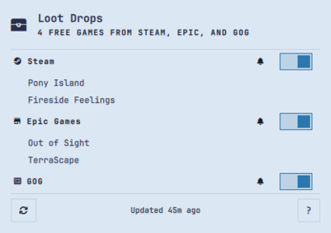
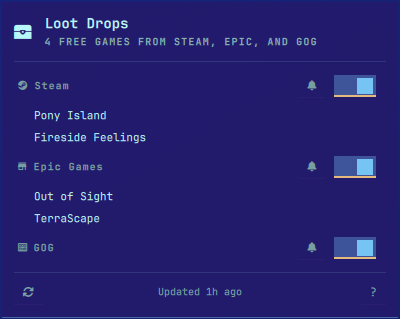
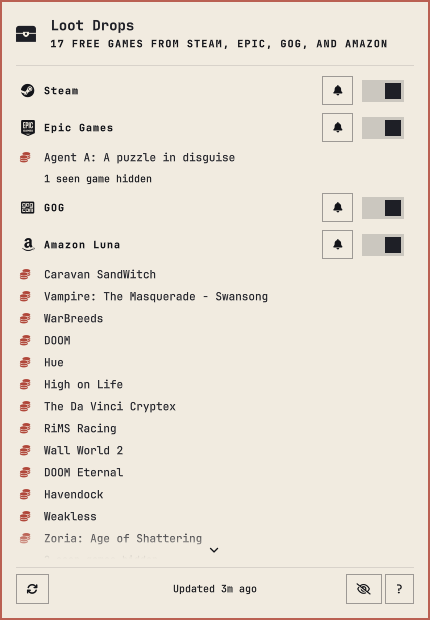
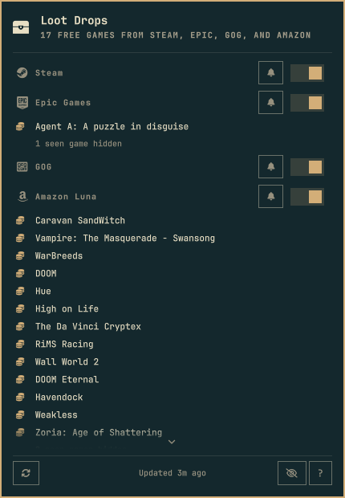
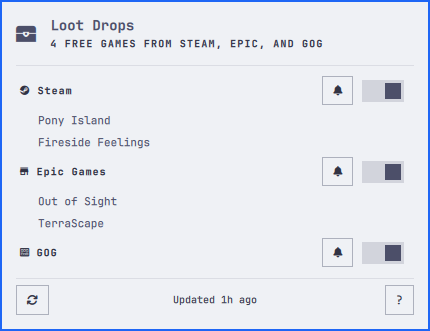

<h1 align="center">Loot Drops</h1>

<p align="center">Never miss a free game drop. Loot Drops watches Steam, Epic Games, GOG, and Amazon Luna for games that are free for a limited time, and alerts you the moment a new one appears.</p>

<p align="center"><a href="https://github.com/tcballard/omarchy-badges"></a></p>

A treasure chest in your bar. Click it and a panel lists everything currently
free to keep, grouped by store, each row one click from the store page. When a
new one appears, you get a desktop notification.

**No accounts. No API keys. No logins.** It reads only the stores' own public
pages, and it never writes anything outside its own state directory.

<p align="center"></p>

**Preview:** Sunlit Sands. A real screenshot from Omarchy 4.0.4-1 on Hyprland,
taken from the live desktop with the panel open. The stores and games in it were
real at capture time, so it will not match what the panel shows later. Desktop
acceptance evidence is in [docs/ACCEPTANCE.json](docs/ACCEPTANCE.json).

## Install

```bash
omarchy plugin add https://github.com/salmun-nister/omarchy-loot-drops --enable right
```

Or clone it yourself and rescan:

```bash
git clone https://github.com/salmun-nister/omarchy-loot-drops \
  ~/.config/omarchy/plugins/salmun-nister.loot-drops
omarchy-shell shell rescanPlugins
omarchy plugin enable salmun-nister.loot-drops right
```

Nothing else to install. `python3`, `curl` and Chromium — all Omarchy base
packages — are already present.

## Removing

```bash
omarchy plugin remove salmun-nister.loot-drops
```

To keep it installed but stop it doing anything, disable it instead:

```bash
omarchy plugin disable salmun-nister.loot-drops
```

Removal takes the plugin folder with it. If you installed it as a plain
directory rather than a git checkout, Omarchy backs that folder up to
`~/.config/omarchy/plugins/.salmun-nister.loot-drops.bak.<timestamp>` instead
of deleting it, so remove it yourself if you want the space back.

Your state file is deliberately kept:
`~/.local/state/salmun-nister.loot-drops/seen.json`. It records what was
already free, so reinstalling does not re-announce games that were free before,
and which games you have marked seen, so your markers survive a reinstall. If
you have used Amazon Luna, that directory also holds the anonymous Chromium
profile its render uses; it carries no account or login. Delete the directory if
you want a clean slate.

Nothing else is changed: no Hyprland setting, and no other entry in
`~/.config/omarchy/shell.json`.

## Using it

| Action | What happens |
| --- | --- |
| Left-click the chest | Open the panel |
| Middle-click the chest | Refresh the stores now |
| Click the eye in the footer | Hide or show the games you have marked seen |
| Click a game | Open its store page and close the panel |
| Click a game's coin | Mark that game as seen, without opening it |
| `r` | Refresh the stores now |
| `e` | Enable or disable that store |
| `n` | Mute or unmute notifications for that store |
| `s` | Toggle the highlighted game's seen state (press again to bring its coin back) |
| `v` | Hide or show the games you have marked seen |
| `j` / `k` | Scroll down / up |
| `?` | Show or hide the shortcut list |
| `Esc` | Close the panel |

The shortcut list lives in the README. If you have forgotten it while the panel
is open, press `?` — or click the `?` in the panel's bottom-right corner — and
it appears above the buttons until you press it again.

A coloured dot sits on the top right of the chest while there are free games you
have not marked as seen. Each such game carries a coin marker to the left of its
title in the panel, and the dot stays until every one of them has been marked:
opening the panel no longer clears it by itself. A game is marked when you open
it or click its coin, or `s` toggles the highlighted one, so a game can be put
back to unseen and its coin brought back. A game that turns up later lights the
dot again. The dot is independent of the
notification bells, so a muted store still shows a dot for something you have not
looked at. Like the notification-center badge, it is drawn over the icon rather
than beside it, so the bar does not change width as games arrive.

Each enabled store gets its own section in the panel, headed by the store's mark
— the real Steam, GOG, Amazon and Epic logos; Epic's is bundled because Nerd
Fonts has no mark for it. The header carries two controls: a **switch** that stops or resumes
watching that store entirely, and a **bell** that mutes or unmutes its
notifications. Games sit slightly indented under their store name. The bell is a
bordered button, the same kind as the footer's Refresh, eye and `?`, so all four
share their outline and hover highlight. Hovering any panel control — the bell,
the switch, Refresh, the eye or `?` — names what it does. Every one takes effect
immediately, and all are saved to your `shell.json`.

`e` and `n` act on whichever store your **pointer is over**, falling back to
whichever store the keyboard cursor last landed on. Hovering a store's name or any
of its games retargets them, so you do not have to move the cursor first.

Hovering a game highlights it exactly as the keyboard cursor does, and the two
never show at once: moving the mouse onto a row clears the keyboard highlight,
and pressing `j`/`k` clears the mouse one. Pressing `j`/`k` while pointing at a
game carries on from that game, so moving from mouse to keyboard starts where
the pointer left off.

Clicking the bell keeps the store listed but silent — a muted store is visibly
different from one you have switched off. A store you have switched off collapses
to a faded row with no games under it, because it is no longer being watched;
its switch stays live so you can turn it back on from there.

The **eye** in the panel's bottom row hides the games you have already marked
seen, store by store. Each store that had some hidden then ends with a dim line
saying how many — `3 seen games hidden` — so the unseen games always read first.
Click it again, press `v`, or set `hideSeen`, to bring them back; the count in
the subtitle still includes the hidden games.

Right-click does nothing, deliberately.

The panel lists every free game, however many there are. The games scroll between
the two rules while the header and the buttons stay put, and a fade with a small
chevron at the top or bottom edge means there is more in that direction; the
scrollbar itself stays out of the way until you scroll. The keyboard cursor
scrolls itself into view.

## Theming

The panel is built from the shell's own theme tokens, so it matches whatever
theme you are running — there is no per-plugin styling to keep in sync. A few of
them:

<table align="center">
<tr>
<td align="center"><br><sub>Aonagi</sub></td>
<td align="center"><br><sub>Sumi Day</sub></td>
</tr>
<tr>
<td align="center"><br><sub>Outpost</sub></td>
<td align="center"><br><sub>Catppuccin Latte</sub></td>
</tr>
</table>

## Settings

Set these on the widget's entry in `~/.config/omarchy/shell.json`, or through the
Omarchy settings UI. They hot-reload on save.

| Setting | Default | What it does |
| --- | --- | --- |
| `refreshMinutes` | `90` | How often to check the enabled stores (30–720). |
| `hideSeen` | `false` | Hide the games you have marked seen, replacing them with a per-store count. The footer's eye toggles it. |
| `steamEnabled` | `true` | Watch Steam. |
| `epicEnabled` | `true` | Watch the Epic Games Store. |
| `gogEnabled` | `true` | Watch GOG. |
| `amazonEnabled` | `false` | Watch Amazon Luna. Off by default because it renders a page in headless Chromium; no account or key is needed. |
| `steamNotify` | `true` | Notify when a Steam game goes free. |
| `epicNotify` | `true` | Notify when an Epic game goes free. |
| `gogNotify` | `true` | Notify when a GOG giveaway runs. |
| `amazonNotify` | `true` | Notify when an Amazon Luna game goes free. |
| `steamCountry` | `""` | Optional two-letter Steam store country (`US`, `DE`, `GB`). Empty lets Steam choose. |

```json
{ "id": "salmun-nister.loot-drops", "refreshMinutes": 90, "gogNotify": false }
```

The switches and bells in the panel write to the same keys, so you can also set
them by hand while the plugin is off. Switching a store **off** stops it being
fetched at all — no request, no rows, no notifications. Switching it back **on**
re-records silently rather than announcing everything it missed while you had it
off.

## How it decides

The default interval trades freshness against how often the stores are asked.
The panel also refreshes itself when you open it and the data is older than a
stale interval, which covers a laptop that was asleep.

The first run is deliberately quiet. It records what is already free without
announcing it, so installing the plugin does not produce a wall of notifications
for games that were free before you asked.

Each store is fetched separately, so one being slow or down never delays or hides
the others. A failed check never erases what you already had: the panel keeps
showing the last good list with the reason attached.

The states are kept apart rather than collapsed into one "no games" message:

| What you see | What it means |
| --- | --- |
| `N games free to keep` | Fetched, and there are some. |
| `Nothing free right now` | Fetched, and there are none. |
| A store header on its own | That store is on and has nothing free today. Normal, and it can still be switched off from there. |
| `Could not reach <store>` | The request failed; the old list is still shown. |
| `Chromium is required but was not installed` | Amazon Luna is switched on but Chromium, its renderer, is missing. |
| `Store returned an unexpected response` | The page did not look like what we expected. |

## What it talks to

Steam, Epic and GOG are one public request each per refresh. Amazon Luna has no
endpoint a script may read, so its signed-out claims page is rendered in
headless Chromium — a base Omarchy package — and the rendered page is what gets
read. That is the only store that launches a browser at refresh time.

| Store | Host |
| --- | --- |
| Steam | `store.steampowered.com` |
| Epic | `store-site-backend-static.ak.epicgames.com` |
| GOG | `www.gog.com` |
| Amazon Luna | `luna.amazon.com` |

Every game link is checked against the store's own host before your browser is
launched, and every game title is stripped of markup and control characters
before it is displayed or sent to the notification server. The Luna render uses
no account, cookie or key from your browser: it opens a fresh signed-out page,
which loads that page's own assets, and nothing else. See
[security](SECURITY.md).

Your plugin state lives in `~/.local/state/salmun-nister.loot-drops/`:
`seen.json`, plus — only while Amazon Luna is switched on — the anonymous
Chromium profile the render uses. Removing the plugin leaves both behind;
delete that directory if you want a clean slate. Nothing else on your system is
touched.

## Not included

Upcoming and announced games, cover art, countdown timers, permanently-free and
free-to-play titles, and store selection for Epic or GOG. GOG's giveaway is a
limited-time claim-and-keep promotion, which is what this tracks — not GOG's
larger free catalogue. Amazon Luna is tracked the same way: its claim-and-keep
games only, so in-game content and Luna's streaming catalogue are out of scope.
The claims grid exposes no end dates, so Amazon rows never carry the
ending-soon hourglass.

## Development

```bash
./tests/run          # portable checks
./tests/harness/run  # the real widget in a real Quickshell, against live stores
```

[Build, run and remove](docs/DEVELOPMENT.md) · [Design record](DESIGN.md) ·
[Architecture](ARCHITECTURE.md) · [Release process](docs/RELEASE.md)

## Compatibility

Intended target: Omarchy 4 / Hyprland. Tested live on **Omarchy 4.0.4-1** with
Hyprland on X11-less Wayland, kernel 7.2.5-3-omarchy: the widget loads on the bar,
the panel opens and closes, all stores resolve, a desktop notification fires on a
newly free game and does not repeat, and the per-store switch and bell states
render. GOG's success path is still fixture-only, because no giveaway was live
when it was tested. Amazon Luna resolved live through the widget's own fetch
path on 19 October 2026: the signed-out claims page rendered in headless
Chromium and listed 15 games, with no login. A vertical bar has not been
observed.

Portable validation additionally covers parsing, the URL allowlist and the
notification diff. See [acceptance evidence](docs/ACCEPTANCE.json) for the exact
commands and results.

## Credits

**Inspired by [Steam Sniper](https://github.com/nille/omarchy-steam-sniper)** by
nille, which watches Steam alone for games that are free to keep. Loot Drops is
an independent work: it adds Epic and GOG, per-store switches and bells, and
keeps a separate baseline for each store.

Steam, Epic Games, GOG, and Amazon Luna are trademarks of their respective
owners. Loot Drops is an independent project, not affiliated with, endorsed by,
or sponsored by them; it only reads their public pages.

Built from [Build Omarchy Plugins](https://github.com/tcballard/build-omarchy-plugins)
guidance and the Omarchy template set. No third-party code is vendored; full
lineage is recorded in [CREDITS.md](CREDITS.md).

## Licence

[MIT](LICENSE). Third-party software and media retain their own licences.
